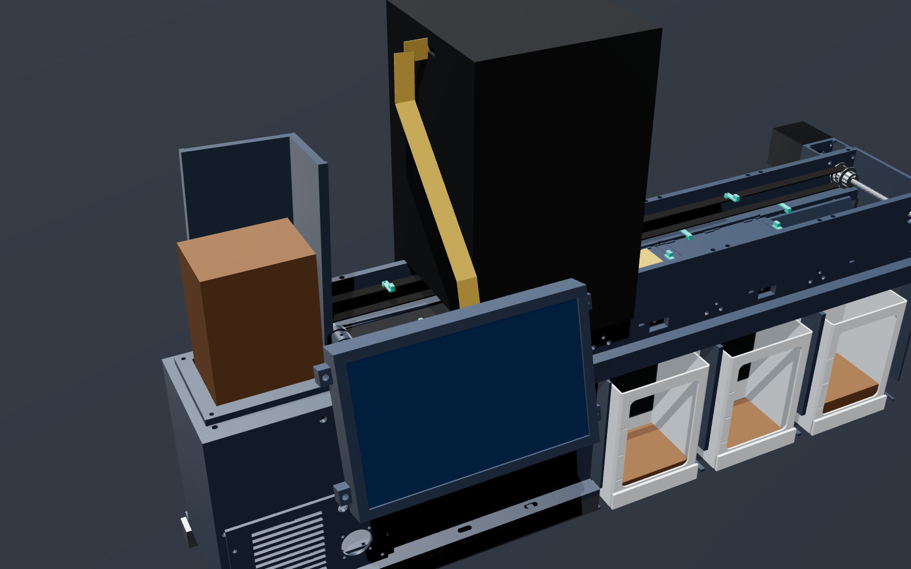

# Card sorter hardware (3-bin prototype, rev A)

- `cad/sorter.py`: parametric CadQuery model of every printed part. `python sorter.py` regenerates `stl/` and `step/`.
- `stl/`: print files (one per part; quantities in the print list).
- `step/`: editable solids for any CAD program (Fusion, FreeCAD, Onshape).
- `sheets/`: drawing sheet per part (views, overall dimensions mm (in), quantity, material, print notes).
- `renders/`: final-look and prototype renders.

Machine coordinates: X along the card path, Y across (front = -Y), Z up. Card floor at Z = 205 mm.
First design pass: nothing printed yet. Test-print the gate plate and an exit roller first to check fits.

## Screen pod

* The touchscreen sits in front of the gap between the hopper tower and the hood, on `mount_wall` (bolted across
  the front walls), tilted back 15°. M5 thumbscrew through the GoPro-style prongs.
* It's a closed **pod**: `screen_cradle` (lips round the glass) + `pod_cover` (black) hide the Pi 5, the 24 V → 5 V
  USB-C converter and every cable. Vents over the Pi's fan and beside the converter.
* Pi's port edge UP. The camera ribbon goes up inside the pod, into `ribbon_duct`, up the gap (rolling 90° gently
  on the way, round bends only) and into the hood's **left** wall, level with the camera. Turn the camera so its
  connector faces left. Run ~340 mm: use a **500 mm (20 in) Pi 5 camera cable**; the spare folds flat in the pod.
* The converter lives in the pod; only its 24 V pair (extend it with 18 AWG, solder + heat-shrink) runs down
  `wire_tube` into the electronics bay through the grommet hole in the bay cover.
* Picture the right way up: `bash ~/mtg-card-scanner/machine/screen-rotate.sh 90` (or 270).

