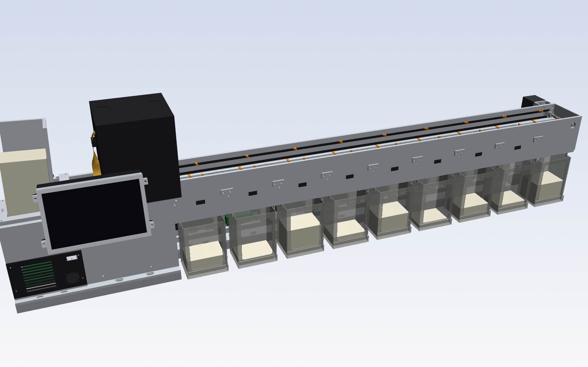
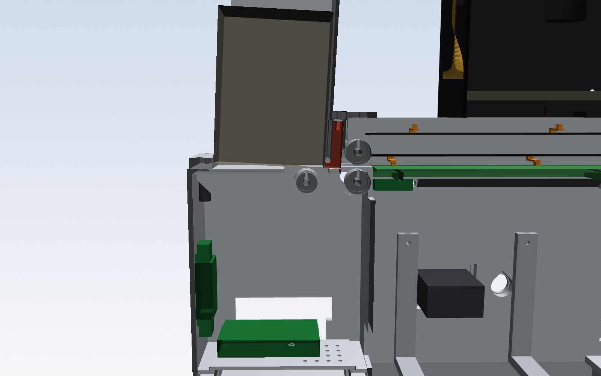
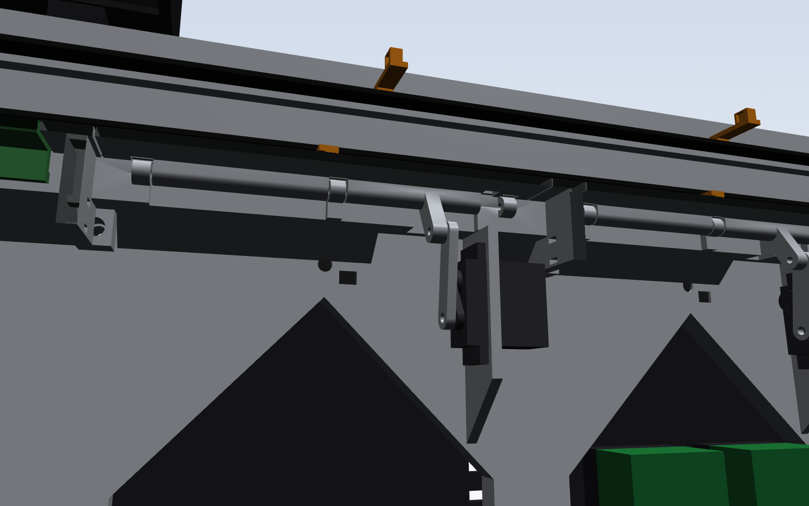
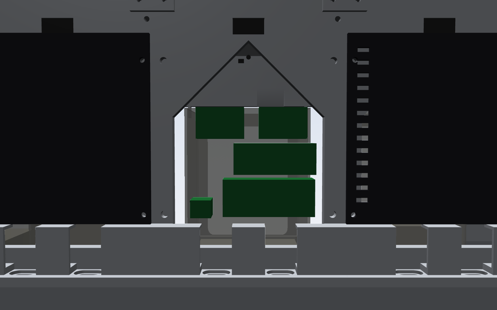
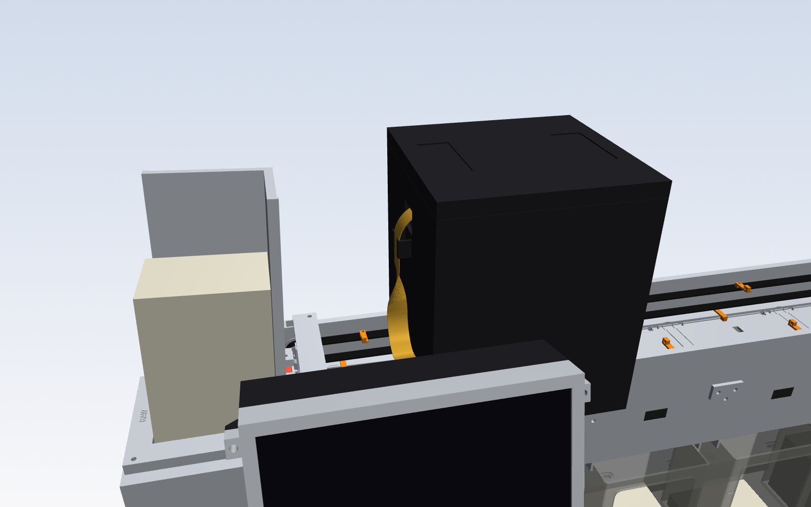
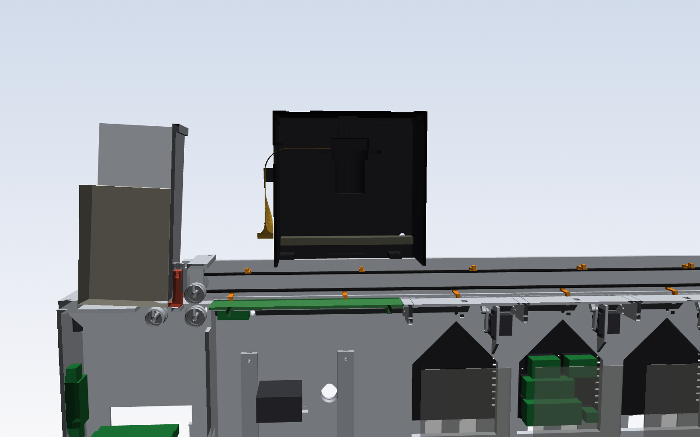
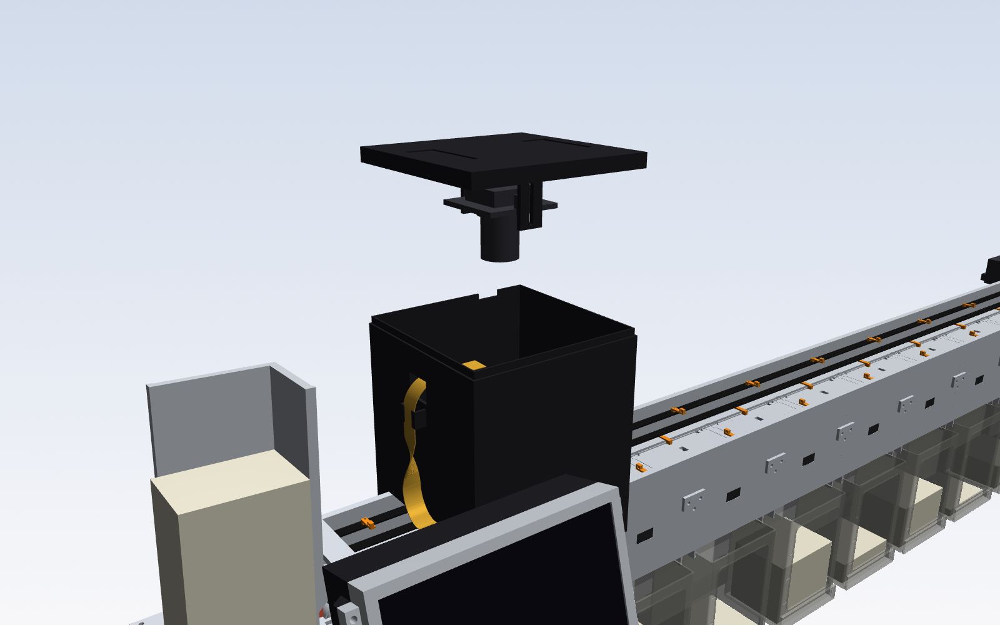

# Card sorter hardware (9 bins)

- `cad/sorter.py`: parametric CadQuery model of every printed part. `python sorter.py` regenerates `stl/` and `step/`.
  It draws the 9-bin machine; `SORTER_BINS=3 python fitcheck.py` checks the 3-bin test build.
- `stl/`, `step/`: print files and editable solids. What to print, how many and in which order: [PRINT_PLAN.md](PRINT_PLAN.md).
- [ASSEMBLY.md](ASSEMBLY.md): putting it together piece by piece (the steps that must come first are marked).
- [WIRING.md](WIRING.md): every cable, where it goes and how long it is.
- `cad/fitcheck.py`: every bought part at datasheet size checked against the printed parts, a card run down the whole
  track, every door swung through its travel, every cable length (`fit_report.json`).
- `sheets/`: drawing sheet per part. `renders/`: pictures.
- [AUDIT.md](AUDIT.md): the rev H design audit (every part, screw, cable, motion and card path checked; what changed). `audit/run_all.sh` re-runs it.
- [PRINT_SETUP.md](PRINT_SETUP.md): printer tune-up, the fresh OrcaSlicer profiles, the calibration order and the test prints (fit-test pieces in `stl/test_sections/`).

Machine coordinates: X along the card path, Y across (front = -Y), Z up. Card floor at Z = 205 mm (8.1 in).
Length 1.47 m (58 in) with 9 bins. Build order: the 3-bin raw-card machine first (feeder, scanner, bin modules 1-2,
end module), then bin modules 3-8 slot in between module 2 and the end module, then the sleeved towers.

## Feeder (v4 base, rev H audit)

* The hopper floor is clear all the way from the entry side to the exit roller (v2 had a locating bar under the exit
  wall that would have stopped every card). Any of the three towers (raw, single-sleeved, double-sleeved) sits flat on
  its skirt with 2 M3 x 16 cap screws; the exit wall is in the same place on all three, so the gate and guides fit all.
* Tower ID: two A3144 hall sensors in pockets in the hopper floor read 6 x 3 mm magnets pressed into the tower's
  skirt (raw = front, single = back, double = both). The app shows which tower is on.
* Pressure roller: on a bridge across the feeder posts, floating in vertical slots over the exit roller.

## Bins

* Doors hinge just outside their back edge on one 2 mm x 100 mm pin through three frame knuckles and two door
  barrels. The servo sits inside the module under the back strip; horn, lever and link make a parallelogram, so the
  door turns exactly as far as the horn (60°). The fit check swings every door through its travel.
* The break-beam crosses the bin mouth under the closed door and shines through a slot in the open door, so the card
  sliding down is what breaks it.
* The **bin hub** on bin module 2's back panel runs every bin: PCA9685 (servos), MCP23017 (beams), two TCA9548A
  (one bin-level sensor per channel, so no address juggling) and a 3.3 V regulator, on one 4-wire bus from the bay.
  Front looms cross to the back along the tie bars; everything runs in the back channel. No wires on the front.

## Screen pod

* The touchscreen sits in front of the gap between the hopper tower and the hood, on `mount_wall` (bolted across
  the front walls), tilted back 15°, M5 thumbscrew through the GoPro-style prongs.
* `screen_cradle` (lips round the glass) + `pod_cover` (black) hide the Pi 5. Vents over the Pi's fan.
* Pi's port edge UP. The camera ribbon only ever bends across its width (never sideways, never folded): out of
  the pod's back, straight back across the gap above the conveyor, a soft bend upward, then up beside the hood's
  left wall, twisting 90 degrees gently over ~64 mm until it lies flat on the wall under a pair of L-rails, and
  over through the slot at camera height straight into the camera. The camera is turned so its connector faces
  left; the hanger ribs are on the front and back so nothing is in the way. Run ~325 mm: 500 mm (20 in) cable.
  
* The 5 V USB-C converter sits in the pod beside the Pi; only its 24 V pair, bundled with the Pi's jumper loom in a
  braided sleeve, hangs free from the pod's bottom notch into the bay-cover slot.
* Picture the right way up: `bash ~/mtg-card-scanner/machine/screen-rotate.sh 90` (or 270).

## Hood and lid

* The camera sits 4.5 in (115 mm) above the card, adjustable 100-135 mm. Close up the 6 mm lens bows the picture
  (fisheye); the machine straightens it in software after a one-time lens calibration (Tools -> Lens photo x8, then Finish lens calibration, with `machine/calibration_board.pdf`).
* The roof is a **lid** (`hood_lid`) with the camera hanging from it: lift it off and set height and focus with
  the camera in your hands, watching the live view. A tongue on the hood sits in a groove between the lid's two
  skirts (light can't get past two right-angle turns) and a key on the back means it only goes on one way.
* LED channels on the front and back walls, 55 mm (2.2 in) above the card, so a glossy card or sleeve reflects them
  away from the lens. Sheen LED: a cut piece (up to 52 mm) of the same COB strip in `sheen_cap` on the back wall, shining in low through a slot: nothing extra to buy.
* Every cable, its route and its length: [WIRING.md](WIRING.md).

