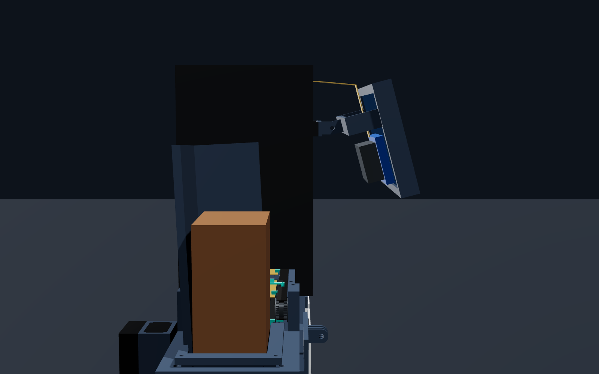

# Card sorter hardware (3-bin prototype, rev A)

- `cad/sorter.py`: parametric CadQuery model of every printed part. `python sorter.py` regenerates `stl/` and `step/`.
- `stl/`: print files (one per part; quantities in the print list).
- `step/`: editable solids for any CAD program (Fusion, FreeCAD, Onshape).
- `sheets/`: drawing sheet per part (views, overall dimensions mm (in), quantity, material, print notes).
- `renders/`: final-look and prototype renders.

Machine coordinates: X along the card path, Y across (front = -Y), Z up. Card floor at Z = 205 mm.
First design pass: nothing printed yet. Test-print the gate plate and an exit roller first to check fits.

## Screen + Pi mount

* The Pi 5 stays screwed to the back of the Touch Display 2 (its display ribbon is short), and the pair drops into
  `screen_cradle` from behind: lips round the glass, open back so the Pi's cooler has free air. A crossbar above the
  Pi carries the GoPro tab that clips onto `mount_front` on the hood (M5 thumbscrew), tilted back 15°.
* Mount it **landscape with the Pi's port edge (USB-C, HDMI, camera ports) UP**. The camera ribbon (305 mm / 12 in)
  leaves the CAM/DISP 0 port straight up, lies flat on the back of the screen under the crossbar, curves over to the
  hood and goes in through the slot in the hood's front wall, level with the camera. Bends only, no twist. The run is
  about 200 mm (8 in), so about 10 cm (4 in) is spare: let it hang in a loose loop behind the screen.
* Turn the camera on its plate so its ribbon connector faces the front (the screen side).
* The ribbon can't jog sideways, so the Pi's camera port has to line up with the camera: `CAM_PORT_X` in
  `cad/sorter.py` shifts the screen left/right to match. Measure the port's offset from the screen's centre line.
* After mounting, set the picture the right way up: `bash ~/mtg-card-scanner/machine/screen-rotate.sh 90` (or 270).

