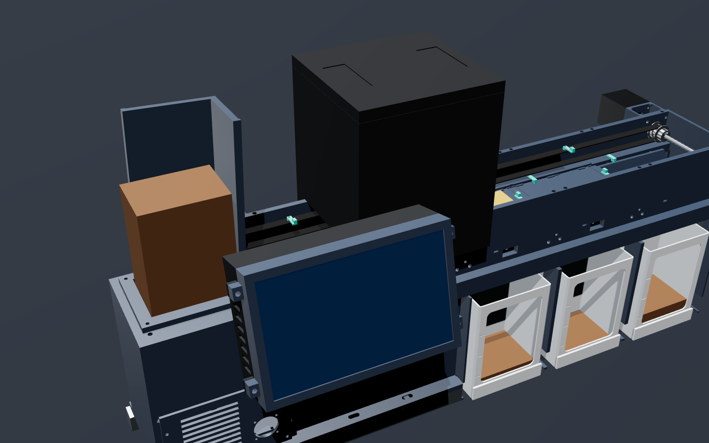

# Card sorter hardware (3-bin prototype, rev A)

- `cad/sorter.py`: parametric CadQuery model of every printed part. `python sorter.py` regenerates `stl/` and `step/`.
- `stl/`: print files (one per part; quantities in the print list).
- `step/`: editable solids for any CAD program (Fusion, FreeCAD, Onshape).
- `sheets/`: drawing sheet per part (views, overall dimensions mm (in), quantity, material, print notes).
- `renders/`: final-look and prototype renders.

Machine coordinates: X along the card path, Y across (front = -Y), Z up. Card floor at Z = 205 mm.
First design pass: nothing printed yet. Test-print the gate plate and an exit roller first to check fits.

## Screen pod

* The touchscreen sits in front of the gap between the hopper tower and the hood, on `mount_wall` (bolted across
  the front walls), tilted back 15°, M5 thumbscrew through the GoPro-style prongs.
* `screen_cradle` (lips round the glass) + `pod_cover` (black) hide the Pi 5. Vents over the Pi's fan.
* Pi's port edge UP. The camera ribbon leaves the back of the pod just above the Pi, crosses the gap behind the
  screen (one soft 45° fold, out of sight) and goes in through a slot low in the hood's LEFT wall, just above the
  conveyor. Inside it runs up the wall under pairs of opposing L-rails (slide it in under them before plugging it
  in), across at camera height beside the camera plate, and into the camera's connector (connector facing the
  front). Run ~445 mm: use a **500 mm (20 in) Pi 5 camera cable**.
* The 5 V USB-C converter stays in the electronics bay; its 12 in USB-C cable hangs free from the bottom of the pod
  straight up to the Pi (~270 mm), in through the hole in the bay cover.
* Picture the right way up: `bash ~/mtg-card-scanner/machine/screen-rotate.sh 90` (or 270).

## Hood and lid

* The camera sits 4.5 in (115 mm) above the card, adjustable 100-135 mm. Close up the 6 mm lens bows the picture
  (fisheye); the machine straightens it in software after a one-time lens calibration (Tools -> Calibrate lens).
* The roof is a **lid** (`hood_lid`) with the camera hanging from it: lift it off and set height and focus with
  the camera in your hands, watching the live view. A tongue on the hood sits in a groove between the lid's two
  skirts (light can't get past two right-angle turns) and a key on the back means it only goes on one way.
* LED channels on the front and back walls, 55 mm (2.2 in) above the card, so a glossy card or sleeve reflects them
  away from the lens. Sheen LED: 20 mm of the same strip in `sheen_cap` on the back wall, shining in low.
* Every cable, its route and its length: [WIRING.md](WIRING.md).

